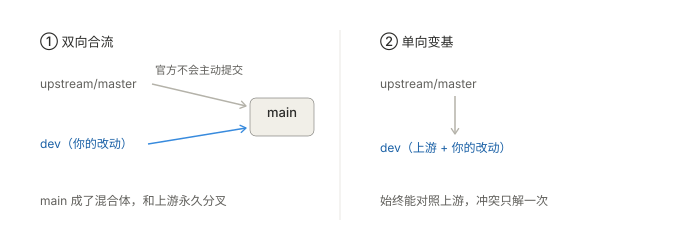
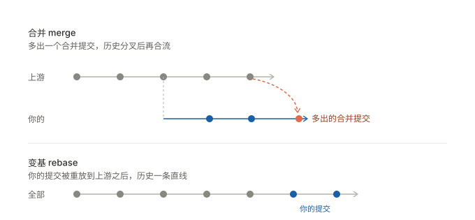

# 千帆云递 · 二次开发说明

> 本仓库 fork 自 [DevilJie/QianFan-Sync](https://github.com/DevilJie/QianFan-Sync)（Apache-2.0）。
> 上游相当活跃——近 30 天 48 次提交，所以这套流程的重点只有一个：**持续跟进上游，同时不丢自己的改动**。

## 一、结论先行

| 问题 | 答案 |
|---|---|
| 上游更新落在哪个分支 | `master`，纯镜像，**永远不在上面提交** |
| 我的改动放在哪 | `dev`，所有开发都在这里 |
| 怎么跟上上游 | `./sync-upstream.sh`，本质是 rebase |
| 要不要再建个 main 做合流层 | 不要，见第二节 |
| GitHub 的 Sync fork 按钮要按吗 | 不用，见第七节 |
| 启动服务用哪个脚本 | `dev-start.bat`，**不要用 `start.bat` 按 Y** |

## 二、分支模型



左边是"上游一个分支、我一个分支、都往 main 合"的设想。技术上能做，但对单人二次开发是纯开销：

- **main 变成混合体**，`git diff upstream/master` 再也说不清"我到底改了什么"
- **冲突要解两遍**：上游合进 main 一次，dev 合进 main 又一次
- **分支数量不改变冲突的数学**，上游该改的还是会改，只是把冲突挪了个位置

右边是当前采用的结构：`dev` 直接叠在上游之上，单向流动。任何时刻 `git diff upstream/master` 就是你的全部改动，一目了然。

顺带一个常被误会的点：**官方不会主动提交**。你 fork 出来的仓库独立存在，上游既不知道也不会往里推东西，所有同步动作都是你主动发起的。

## 三、仓库现状

| 项 | 值 |
|---|---|
| `upstream` | 官方仓库，只读；push 地址被设为 `NO_PUSH_ALLOWED` 防误推 |
| `origin` | 你的 fork，`dev` 推上去当备份 |
| `master` | 跟踪 `upstream/master`，`git status` 直接告诉你落后多少 |
| `dev` | 跟踪 `origin/dev`，你的开发线 |
| 下载源 | 直连优先，失败自动切 `ghproxy.net` / `ghfast.top` 镜像 |

已开启的 git 配置：`rerere.enabled`（记住冲突解法）、`merge.conflictstyle=zdiff3`（冲突显示原始版本）、`rebase.autoStash`（自动暂存）、`core.autocrlf=false`（避免行尾污染 diff）。

## 四、日常操作

```bash
git checkout dev              # 1. 开工前确认在 dev

./sync-upstream.sh --check    # 2. 同步前先看：上游新提交 + 冲突预警

./sync-upstream.sh            # 3. 确认后执行变基
```

启动服务：Windows 用 `dev-start.bat`，Linux/macOS 用 `./dev-start.sh`。

提交习惯：一句话一个提交。变基冲突是按提交逐个解的，攒成巨型提交后你根本分不清哪部分该留。

## 五、三个必须知道的坑

**1. `start.bat` 的「是否更新」提示，绝不能按 Y**

按 Y 会执行 `git remote set-url origin 官方地址` + `git checkout -f master` + `git reset --hard`，三重后果：把你从 dev 强制切走、清空未提交改动、篡改 origin 指向。脚本提示只写了"覆盖本地修改"，没提这些。

`dev-start.bat` / `dev-start.sh` 只做一件事：设 `SAU_JUST_UPDATED=1` 让它跳过整段更新逻辑。没改上游任何文件，所以零冲突。

**2. `data/` 不在 git 里，但里面有你的账号状态**

cookies、SQLite 数据库、素材都在 `data/` 下，已被忽略。好处是同步上游不动你的登录态；代价是换机器要单独备份：

```bash
tar -czf ../qianfan-data-$(date +%Y%m%d).tar.gz data/
```

**3. 别改 `.gitignore` 和启动脚本**

上游也在改这两个。需要额外忽略规则就写进 `.git/info/exclude`（本地生效、不进版本库）。真必须改，先登记到 `PATCHES.md`。

## 六、改哪里最省冲突

冲突只发生在"你和上游都改过的文件"上。选址比技巧重要。

| 层级 | 做法 | 冲突概率 |
|---|---|---|
| 绿 | **新增独立文件**，不碰任何已有文件 | 几乎为 0 |
| 黄 | 在列表**末尾追加一行**（如注册新平台） | 低 |
| 橙 | 改配置、常量、独立工具函数 | 中 |
| 红 | 改核心流程文件 | 必然冲突 |

上游近 90 天改动最频繁的文件，尽量绕开：

| 次数 | 文件 |
|---|---|
| 21 | `frontend/src/views/PublishCenter.vue` |
| 12 | `backend/impl/channels/platform.py` |
| 11 | `backend/impl/weixin_gzh/platform.py` |
| 11 | `backend/app.py` |
| 9 | `frontend/src/views/ArticlePublish.vue` |
| 9 | `backend/services/draft_merge.py` |

**最典型的扩展场景（加平台）几乎零冲突：**

```bash
cp -r backend/impl/zhihu backend/impl/myplatform   # 拿现有平台当模板
# 改类名、platform_key 和实现，然后在 registry.py 的 imports 列表末尾加一行：
# (22, ".myplatform.platform", "MyPlatform"),
```

只有最后这一行碰上游文件，加在末尾，冲突概率极低。

## 七、GitHub 网页上的两个按钮

**`Sync fork`：不用按。** 它只把你 fork 的默认分支 `master` 快进到上游最新，**完全不碰 `dev`**。而你本地的 `git fetch upstream` 是直连官方的，跟你 fork 的 master 是否落后毫无关系。真正让改动适配上游的动作只有本地 rebase。

一个要避开的坑：**别把 `dev` 设成 fork 的默认分支**。否则点 Sync fork 时 GitHub 会发现 `dev` 上有你的提交，弹出 `Discard N commits`，手一抖点下去，远程 dev 就被重置成上游代码了。

**`Compare & pull request`：别点。** 推送 `dev` 后 GitHub 会弹黄条提示，那是给**上游作者**发 PR 的入口（base 是 `DevilJie:master`）。真提交了就是把 `my_readme.md`、`sync-upstream.sh` 这些私人方案文件送去给人家审。忽略即可，没有副作用。

## 八、同步机制：为什么是 rebase 不是 merge



上图上半部分是 merge：多出一个合并提交，历史分叉后再合流。下半部分是 rebase：你的提交被重放到上游之后，始终一条直线。

上游每周十几次提交，跑几个月后 merge 的历史会变成一张网。rebase 则让你始终只需面对一条线，且 `git diff upstream/master` 永远是"我的全部改动"这个干净的答案。

## 九、冲突了怎么办

```bash
git status                     # 1. 看哪些文件冲突
# 2. 编辑文件，搜索 <<<<<<< 标记
#    <<<<<<< HEAD          你的改动
#    ||||||| 原始版本       （zdiff3 提供）
#    =======
#    >>>>>>> upstream      上游的改动
git add <冲突文件>              # 3. 标记已解决
git rebase --continue          # 4. 继续（会逐个提交推进）

./sync-upstream.sh --abort     # 全部放弃，回到同步前
```

**判断原则**：上游在持续演进，他们的重构通常比你的补丁更合理。所以先**接受上游的新写法**，再把你的意图重新实现一遍。别死守旧代码，否则一次比一次难合。

每次同步前脚本会自动打 `sync-backup-<时间戳>` 标签：

```bash
git tag -l "sync-backup-*" | tail -3
git reset --hard sync-backup-20261113-090000
```

## 十、FAQ

**Q：`master` 和 `dev` 能合并吗？**
不用合，也没东西可合。`dev` 从 `master` 长出来，天然包含它的全部提交，在 `dev` 上 `git merge master` 只会返回 `Already up to date.`。反过来把 `dev` 合进 `master` 会毁掉镜像的对照能力。

**Q：把 `master` 搞坏了怎么救？**
它不承载任何独有信息，随时重建：

```bash
git checkout master
git fetch upstream
git reset --hard upstream/master
git push -f origin master
```

**Q：上游更新太频繁，每周都冲突？**
说明改动落在第六节的红色区域了。要么把改动挪进新增文件，要么提高同步频率——**频率越高，单次冲突越小**，每周同步通常比每月更轻松。

**Q：推送失败？**
变基会重写历史，所以推 dev 必须强推，但用 `--force-with-lease` 而不是 `--force`（远端有别人的新提交时会拒绝，避免覆盖）：

```bash
git push --force-with-lease origin dev
```

**Q：镜像挂了，脚本报「所有源都连不上」？**

```bash
SYNC_SRC=https://kkgithub.com/DevilJie/QianFan-Sync.git ./sync-upstream.sh
```

或修改脚本顶部的 `CANDIDATES` 数组。实测镜像波动很大，别写死一个源。

**Q：想给上游提 PR？**

```bash
git checkout -b pr/my-feature upstream/master
git cherry-pick <你的提交>
git push -u origin pr/my-feature
```

然后去 GitHub 选 `Compare & pull request`，目标选 `DevilJie/QianFan-Sync:master`。

---

配套文件：`sync-upstream.sh`（同步脚本）、`PATCHES.md`（上游文件改动登记簿）、`dev-start.bat` / `dev-start.sh`（启动入口）。
